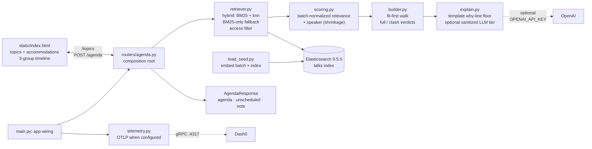

# TalkFinder

Paste your interests, get one clash-free agenda for the day — with an honest
why-line for every pick. A hackathon-built, single-page FastAPI app for **one
conference attendee**: pick topics and accommodations, and the pipeline finds
the talks you can actually attend (full rooms and clashes are flagged, never
hidden).

## Stack

- **FastAPI** + a single-file static UI (plain CSS, vanilla JS — no build step)
- **Elasticsearch 9.5.5** (local, single node, security off) for hybrid search
- **OpenAI** (optional): query embeddings + recipe why-lines; the app degrades
  to BM25-only search and template why-lines without a key
- **OpenTelemetry** → Dash0 (optional, env-gated)
- **uv** (Python 3.14), **pytest**

## Quickstart

```bash
# 1. Dependencies (uv: https://docs.astral.sh/uv/)
uv sync

# 2. Config — copy the placeholders, fill in what you have
cp .env.example .env    # ES_URL defaults to http://localhost:9200

# 3. Elasticsearch (waits for a green cluster)
docker compose up -d && docker compose ps   # wait for (healthy)

# 4. Load the seed: 12 talks, one day (embedded + indexed, idempotent)
uv run python load_seed.py

# 5. Serve
uv run uvicorn main:app --reload
```

Then open **http://localhost:8000** — pick interests, optionally tick
accommodations, and show your agenda.

## What the day looks like

The pipeline runs in a fixed order, one stage per module, all speaks plain dicts:

